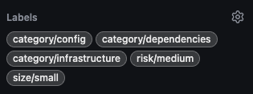

# PR Insights Labeler

[](https://opensource.org/licenses/MIT)
[](https://www.typescriptlang.org/)


**GitHub Actions 向けの PR 解析・自動ラベリングツール**です。プルリクエストの分類・サイズ判定・リスク評価を自動で行います。

🇯🇵 [日本語](README.ja.md) | 🇬🇧 [English](README.md)

## ✨ PR Insights Labeler を選ぶ理由

PR レビューの優先順位付けや確認作業を自動化して、レビュー体験を効率化します。

- **📏 正確なサイズ判定**: PR の規模（small〜xxlarge）を自動で判定・ラベリングし、レビューの優先順位付けを支援します
  - **除外対象**: ロックファイル、生成ファイル、テストファイル（スナップショットを含む）、ドキュメント用メタデータを除外し、実コードの変更規模を正確に計測します
  - 例: `size/small`, `size/medium`, `size/large`, `size/xlarge`, `size/xxlarge`
- **🏷️ 自動カテゴリ分類**: テスト、ドキュメント、CI/CD、設定、仕様書、依存関係などの変更種別を自動で分類し、PR の絞り込みを容易にします
  - **全ファイル対象**: `.kiro/` や `.claude/` などのメタデータファイルも含めて分類します
  - 例: `category/tests`, `category/documentation`, `category/ci-cd`, `category/config`, `category/spec`
- **⚠️ リスク評価**: テストを伴わないコアコードの変更などを検知し、マージ前に注意を促します
  - **実行コードに特化**: ドキュメントやメタデータを除外し、アプリケーションコードのリスクに絞って評価します
  - 例: `risk/high`（テスト更新を伴わないコア変更）、`risk/medium`（設定・インフラ変更）
- **🧠 複雑度の可視化**: 変更ファイルの ESLint 複雑度を計測し、基準を超えた場合に `complexity/high` を付与します（オプトイン）
- **📁 パスベースのカスタムラベル**: 柔軟な glob パターンを使って、ファイルパスに応じた独自のラベルを付与できます
  - 例: `frontend/**` → `team/frontend`, `backend/**` → `team/backend`
- **🏷️ ラベルの自動作成**: リポジトリに未作成のラベルを自動で作成し、メタデータも同期するため事前準備は不要です
- **🚦 品質ゲート**: `fail_on_pr_size`、`fail_on_large_files`、`fail_on_too_many_files` を使い、ポリシー違反時にワークフローを失敗させられます
- **📝 GitHub Actions Summary**: サイズ超過ファイルの一覧や改善のヒントを Actions Summary ページにまとめて表示します
- **🌐 多言語出力**: `language` 入力、`.github/pr-labeler.yml`、`LANGUAGE` / `LANG` 環境変数に応じて、英語と日本語の出力を自動で切り替えます

## 🚀 クイックスタート

2分ほどで導入できます。

### 1. ワークフローファイルを作成する

`.github/workflows/pr-labeler.yml` を作成します。

```yaml
name: PR Insights Labeler

on:
  pull_request:
    types: [opened, synchronize, reopened]

jobs:
  label:
    runs-on: ubuntu-latest

    permissions:
      contents: read        # PRファイル読み取り
      pull-requests: write  # ラベル適用
      issues: write         # コメント投稿

    steps:
      - uses: actions/checkout@v7
      - uses: jey3dayo/pr-insights-labeler@v1
        with:
          github_token: ${{ secrets.GITHUB_TOKEN }}
          # 言語の上書き指定（ワークフロー入力が最優先）
          # language: "ja"  # 省略時は pr-labeler.yml → LANGUAGE/LANG → デフォルト 'en'
```

### 2. 自動で適用される内容

設定を終えると、すべての PR に次のラベルやレポートが自動で出力されます。

- **サイズラベル**: `size/small`, `size/medium`, `size/large`, `size/xlarge`, `size/xxlarge`
- **カテゴリラベル**: `category/tests`, `category/documentation`, `category/ci-cd`, `category/dependencies` など
- **リスクラベル**: `risk/high`, `risk/medium`（リスクを検出した場合のみ）
- **複雑度ラベル**: ESLint の複雑度がしきい値を超えた場合に `complexity/high` を付与（有効化時）
- **GitHub Actions Summary**: CI の結果ページにメトリクス、違反一覧、改善のヒントを表示

### ラベル表示サンプル

PR に自動適用されたラベルは、GitHub 上で次のように表示されます。



### 3. カスタマイズ（任意）

しきい値・ラベル・品質ゲートは、ワークフロー入力、設定ファイル（`.github/pr-labeler.yml`）、またはパスベースのルール（`.github/directory-labeler.yml`）で調整できます。まずは下のサンプルを参考にし、詳細は[設定ガイド](docs/en/configuration.md)をご覧ください。

#### ワークフローサンプル

- [basic.yml](examples/workflows/basic.yml) - デフォルト設定の例
- [advanced.yml](examples/workflows/advanced.yml) - オプション機能を有効にした例

**ドキュメント**: [設定ガイド](docs/en/configuration.md) | [高度な使用例](docs/ja/advanced-usage.md) | [ラベルルール](docs/ja/labeling-rules.md)

## 🔒 権限設定

このアクションの実行には、次の GitHub Actions 権限が必要です。

```yaml
permissions:
  contents: read        # PRファイル読み取り
  pull-requests: write  # ラベル適用・削除
  issues: write         # PRコメント投稿
```

**フォーク PR**: `pull_request_target` イベントを使用してください。詳しくは[フォーク PR の取り扱い](docs/ja/advanced-usage.md#フォークprの取り扱い)を参照してください。

## 🏷️ 適用されるラベル

### サイズラベル（追加行数ベース）

| ラベル         | 追加行数  | 目安             |
| -------------- | --------- | ---------------- |
| `size/small`   | < 200     | 短時間でレビュー |
| `size/medium`  | 200-499   | 通常レビュー     |
| `size/large`   | 500-999   | 集中して確認     |
| `size/xlarge`  | 1000-2999 | 分割を推奨       |
| `size/xxlarge` | ≥ 3000    | 分割が必要       |

### カテゴリラベル

変更されたファイルのパスから、変更種別を自動で判定します。

| ラベル                    | マッチ対象     | 例                         |
| ------------------------- | -------------- | -------------------------- |
| `category/tests`          | テストファイル | `**/*.test.ts`             |
| `category/ci-cd`          | CI/CD 設定     | `.github/workflows/**`     |
| `category/documentation`  | ドキュメント   | `docs/**`, `*.md`          |
| `category/config`         | 設定ファイル   | `*.config.js`, `.env`      |
| `category/spec`           | 仕様書         | `.kiro/specs/**`           |
| `category/dependencies`   | ロックファイル | `package-lock.json`        |
| `category/feature`        | 新機能         | `src/features/**`          |
| `category/infrastructure` | インフラ       | `Dockerfile`, `.github/**` |
| `category/security`       | セキュリティ   | `**/auth*/**`, `.env*`     |

カテゴリラベルの詳しいルールは[カテゴリガイド](docs/en/categories.md)を参照してください。

### リスクラベル

PR の変更内容から、潜在的な影響度と安全性を評価します。

- `risk/high` - 慎重なレビューが必要な高リスク変更
  - CI チェックの失敗（tests、type-check、build、lint）
  - テストファイルを含まないコア機能の新規追加
- `risk/medium` - 注意が必要な中リスク変更
  - 設定ファイルの変更（`.github/workflows/**`、`package.json`、`tsconfig.json`）
  - インフラやデプロイに関連する変更

#### リスクラベルが付かない変更（安全な変更）

- すべての CI チェックに通過したリファクタリング
- ドキュメントのみの変更
- テストのみの変更

詳しい評価ロジックと FAQ は[リスクラベル詳細](docs/en/configuration.md#risk-labels)を参照してください。

### 違反ラベル

設定した上限を超えた場合に付与されます。

- `auto/large-files` - 個別ファイルのサイズが上限を超えています（`file_size_limit_enabled: "false"` で無効化できます）
- `auto/too-many-files` - 変更ファイル数が上限を超えています（`pr_files_limit_enabled: "false"` で無効化できます）
- `auto/too-many-lines` - 個別ファイルの行数が上限を超えています（`file_lines_limit_enabled: "false"` で無効化できます）
- `auto/excessive-changes` - PR 全体の追加行数が上限を超えています（`pr_additions_limit_enabled: "false"` で無効化できます）

**カスタマイズ**: すべてのしきい値とラベル名は変更できます。詳細は[設定ガイド](docs/en/configuration.md#label-thresholds-defaults)を参照してください。

## ⚙️ 設定

### 主なオプション

品質ゲート（`fail_on_*`）はデフォルトで無効です。次のサンプルは有効化した設定例のため、そのままコピーすると上限超過時にワークフローが失敗します。

```yaml
- uses: jey3dayo/pr-insights-labeler@v1
  with:
    github_token: ${{ secrets.GITHUB_TOKEN }}

    # サイズ制限
    file_size_limit: "100KB"           # 個別ファイルの最大サイズ
    file_size_limit_enabled: "true"    # false でサイズチェックとラベル付与をスキップ
    file_lines_limit: "500"            # 個別ファイルの最大行数
    file_lines_limit_enabled: "true"   # false で行数チェックとラベル付与をスキップ
    pr_additions_limit: "5000"         # PR全体の最大追加行数
    pr_additions_limit_enabled: "true" # false で追加行数チェックとラベル付与をスキップ
    pr_files_limit: "50"               # 最大変更ファイル数
    pr_files_limit_enabled: "true"     # false でファイル数チェックとラベル付与をスキップ

    # ラベル制御
    size_enabled: "true"          # サイズラベルを有効化
    category_enabled: "true"      # カテゴリラベルを有効化
    risk_enabled: "true"          # リスクラベルを有効化
    complexity_enabled: "false"   # 複雑度ラベル（デフォルトは無効）

    # 品質ゲート（デフォルトは無効。以下は有効化する場合の指定例）
    fail_on_pr_size: "xlarge"      # PRサイズが上限以上のときに失敗
    fail_on_large_files: "true"    # ファイルサイズ・行数超過時に失敗
    fail_on_too_many_files: "true" # 変更ファイル数超過時に失敗
    enable_summary: "true"         # GitHub Actions Summary に出力
    comment_on_pr: "auto"          # コメント投稿方針（auto / always / never）

    # ローカライズ
    language: "ja"                # ワークフロー単位の最優先指定
    # 省略時: .github/pr-labeler.yml → LANGUAGE/LANG 環境変数 → デフォルト 'en'
```

### 高度な機能

- **ディレクトリベースラベル**: ファイルパスのパターンに応じてカスタムラベルを付与します
- **フォーク PR サポート**: `pull_request_target` を使って安全に解析します
- **条件付き実行**: ラベル・ブランチ・パスに応じてチェックをスキップできます
- **カスタムしきい値**: サイズや複雑度の基準をプロジェクトに合わせて調整できます

👉 **詳しいドキュメント**: [設定ガイド](docs/en/configuration.md) | [高度な使用例](docs/ja/advanced-usage.md)

## 📚 ドキュメント

| ガイド                                               | 説明                         |
| ---------------------------------------------------- | ---------------------------- |
| [ドキュメントインデックス](docs/README.md)           | 言語別のドキュメント一覧     |
| [設定ガイド](docs/en/configuration.md)               | 全入力・出力とデフォルト値   |
| [高度な使用例](docs/ja/advanced-usage.md)            | 実践的な設定例と運用パターン |
| [トラブルシューティング](docs/en/troubleshooting.md) | よくある問題と解決策         |
| [API 仕様書](docs/ja/API.md)                         | 内部 API ドキュメント        |
| [リリース手順](docs/ja/release-process.md)           | バージョン管理とリリース手順 |

## 🤝 コントリビューション

コントリビューションを歓迎します。変更を送る際は、次の点をご確認ください。

1. 大きな変更を行う前に Issue を作成してください
2. プッシュ前にローカルで品質チェックを実行してください（`mise run ci` または `pnpm lint && pnpm test && pnpm build`）
3. 既存のコードスタイルに合わせて実装してください

開発ルール・PR ワークフロー・リリース手順の詳細は [AGENTS.md](AGENTS.md) を参照してください。

### メンテナー向け: リリース手順

リリースには自動リリーススクリプトを使用します。

```bash
# 対話的リリース（バージョンを選択して実行）
mise release

# または直接実行
bash scripts/release.sh
```

スクリプトは次の処理を自動で実行します。

1. 未コミットの変更がないか確認する
2. リリース種別（patch / minor / major）を選択する
3. 品質チェック（lint / test / build）を実行する
4. git コミット履歴から Changelog を生成する
5. `package.json` と `CHANGELOG.md` を更新する
6. コミットとタグを作成する
7. `origin` へプッシュし、GitHub Release を作成する

詳細は[リリース手順](docs/ja/release-process.md)を参照してください。

## 📄 ライセンス

MIT License です。詳細はリポジトリの `LICENSE` ファイルを参照してください。

## 🙏 使用ライブラリ

- [neverthrow](https://github.com/supermacro/neverthrow) - 型安全なエラーハンドリング
- [minimatch](https://github.com/isaacs/minimatch) - Glob パターンマッチング
- [bytes](https://github.com/visionmedia/bytes.js) - ファイルサイズのパース処理
- [@actions/toolkit](https://github.com/actions/toolkit) - GitHub Actions SDK
