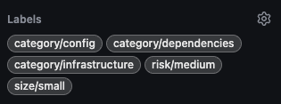

# PR Insights Labeler

[](https://opensource.org/licenses/MIT)
[](https://www.typescriptlang.org/)


**Comprehensive PR insights and labeling for GitHub Actions** - Automatically categorize, size, and assess risk of your pull requests.

🇬🇧 [English](README.md) | 🇯🇵 [日本語](README.ja.md)

## ✨ Why PR Insights Labeler?

Streamline your PR review process with intelligent automation:

- **📏 Smart Size Detection**: Automatically label PRs by size (small → xxlarge) to help reviewers prioritize
  - **Excludes**: Lock files, generated files, test files (including snapshot files), and documentation metadata for accurate code size measurement
  - Example: `size/small`, `size/medium`, `size/large`, `size/xlarge`, `size/xxlarge`
- **🏷️ Auto-Categorization**: Classify changes by type (tests, docs, CI/CD, config, specs, dependencies) for quick filtering
  - **All files**: Including metadata files (`.kiro/`, `.claude/`, etc.) for comprehensive classification
  - Example: `category/tests`, `category/documentation`, `category/ci-cd`, `category/config`, `category/spec`
- **⚠️ Risk Assessment**: Flag high-risk changes (core modifications without tests) before merge
  - **Code files only**: Excludes documentation and metadata to focus on executable code risks
  - Example: `risk/high` (core changes without test updates), `risk/medium` (config/infrastructure changes)
- **🧠 Complexity Insights**: Measure ESLint complexity for changed files and surface `complexity/high` labels (opt-in)
- **📁 Path-Based Labels**: Custom labels based on file paths using flexible glob patterns
  - Example: `frontend/**` → `team/frontend`, `backend/**` → `team/backend`
- **🏷️ Auto Label Provisioning**: Automatically create and sync labels with default metadata—no manual setup required
- **🚦 Workflow Quality Gates**: Enforce policy with `fail_on_pr_size`, `fail_on_large_files`, and `fail_on_too_many_files`
- **📝 GitHub Actions Summary**: Publish rich PR analytics, large file tables, and improvement suggestions to the Actions Summary page
- **🌐 Multi-language Output**: Automatically switch between English and Japanese via the `language` input, `.github/pr-labeler.yml`, or `LANGUAGE/LANG` environment

## 🚀 Quick Start

Get started in 2 minutes:

### 1. Create Workflow File

Add `.github/workflows/pr-labeler.yml`:

```yaml
name: PR Insights Labeler

on:
  pull_request:
    types: [opened, synchronize, reopened]

jobs:
  label:
    runs-on: ubuntu-latest

    permissions:
      contents: read        # Read PR files
      pull-requests: write  # Apply labels
      issues: write         # Post comments

    steps:
      - uses: actions/checkout@v4
      - uses: jey3dayo/pr-insights-labeler@v1
        with:
          github_token: ${{ secrets.GITHUB_TOKEN }}
          # Optional language override (workflow input has highest priority)
          # language: "ja"  # Otherwise falls back to pr-labeler.yml → LANGUAGE/LANG → default 'en'
```

### 2. What You Get

Once configured, every PR automatically receives:

- **Size labels**: `size/small`, `size/medium`, `size/large`, `size/xlarge`, `size/xxlarge`
- **Category labels**: `category/tests`, `category/documentation`, `category/ci-cd`, `category/dependencies`, etc.
- **Risk labels**: `risk/high`, `risk/medium` (when applicable)
- **Complexity labels**: `complexity/high` when ESLint complexity thresholds are exceeded (if enabled)
- **GitHub Actions Summary**: Consolidated metrics, violation tables, and best-practice reminders directly in CI results

### Sample Label Preview

Here's how the automatically applied labels appear on a pull request (GitHub label screenshot):



### 3. Customize (Optional)

Every threshold, label, and quality gate can be tuned with workflow inputs, a `.github/pr-labeler.yml` configuration file, or path-based rules in `.github/directory-labeler.yml`. Start from an example below, then see the [Configuration Guide](docs/en/configuration.md) for all options.

#### Workflow examples

- [basic.yml](examples/workflows/basic.yml) - Default settings
- [advanced.yml](examples/workflows/advanced.yml) - With optional features

**Docs:** [Configuration](docs/en/configuration.md) | [Advanced Usage](docs/en/advanced-usage.md) | [Labeling Rules](docs/en/labeling-rules.md)

## 🔒 Permissions

Required GitHub Actions permissions:

```yaml
permissions:
  contents: read        # Read PR files
  pull-requests: write  # Apply/remove labels
  issues: write         # Post PR comments
```

**Fork PRs**: Use `pull_request_target` event. See [Fork PR Handling](docs/en/advanced-usage.md#fork-pr-handling).

## 🏷️ Labels Applied

### Size Labels (additions-based)

| Label          | Lines Added | Use Case          |
| -------------- | ----------- | ----------------- |
| `size/small`   | < 200       | Quick reviews     |
| `size/medium`  | 200-499     | Normal reviews    |
| `size/large`   | 500-999     | Requires focus    |
| `size/xlarge`  | 1000-2999   | Split recommended |
| `size/xxlarge` | ≥ 3000      | Should be split   |

### Category Labels

Automatically detect change types:

| Label                     | Matches        | Example                    |
| ------------------------- | -------------- | -------------------------- |
| `category/tests`          | Test files     | `**/*.test.ts`             |
| `category/ci-cd`          | CI/CD configs  | `.github/workflows/**`     |
| `category/documentation`  | Docs           | `docs/**`, `*.md`          |
| `category/config`         | Config files   | `*.config.js`, `.env`      |
| `category/spec`           | Specifications | `.kiro/specs/**`           |
| `category/dependencies`   | Lock files     | `package-lock.json`        |
| `category/feature`        | New features   | `src/features/**`          |
| `category/infrastructure` | Infrastructure | `Dockerfile`, `.github/**` |
| `category/security`       | Security       | `**/auth*/**`, `.env*`     |

See the [Category Guide](docs/en/categories.md) for detailed information about category labels.

### Risk Labels

Assess the potential impact and safety of PR changes:

- `risk/high` - High-risk changes requiring careful review
  - CI checks failed (tests, type-check, build, or lint)
  - New features in core code without test files
- `risk/medium` - Medium-risk changes requiring attention
  - Configuration file changes (`.github/workflows/**`, `package.json`, `tsconfig.json`)
  - Infrastructure or deployment changes

**No risk label** applied for safe changes:

- Refactoring with all CI checks passing
- Documentation-only changes
- Test-only changes

See [Risk Label Details](docs/en/configuration.md#risk-labels) for complete evaluation logic and FAQ.

### Violation Labels

When limits exceeded:

- `auto/large-files` - Individual files too large (disable with `file_size_limit_enabled: "false"`)
- `auto/too-many-files` - Too many files changed (disable with `pr_files_limit_enabled: "false"`)
- `auto/too-many-lines` - Individual files exceed configured line limits (disable with `file_lines_limit_enabled: "false"`)
- `auto/excessive-changes` - Total additions exceed configured thresholds (disable with `pr_additions_limit_enabled: "false"`)

**Customize**: All thresholds and labels configurable. See [Configuration Guide](docs/en/configuration.md#label-thresholds-defaults).

## ⚙️ Configuration

### Common Options

The quality gates (`fail_on_*`) are disabled by default. The sample below enables them, so copying it as-is makes the workflow fail when a limit is exceeded.

```yaml
- uses: jey3dayo/pr-insights-labeler@v1
  with:
    github_token: ${{ secrets.GITHUB_TOKEN }}

    # Size Limits
    file_size_limit: "100KB"      # Max file size
    file_size_limit_enabled: "true" # Disable to skip per-file size checks/labels
    file_lines_limit: "500"       # Max lines per file
    file_lines_limit_enabled: "true" # Disable to skip per-file line checks/labels
    pr_additions_limit: "5000"    # Max total additions
    pr_additions_limit_enabled: "true" # Disable to skip additions-limit checks/labels
    pr_files_limit: "50"          # Max changed files
    pr_files_limit_enabled: "true" # Disable to skip file-count checks/labels

    # Label Control
    size_enabled: "true"          # Enable size labels
    category_enabled: "true"      # Enable category labels
    risk_enabled: "true"          # Enable risk labels
    complexity_enabled: "false"   # Complexity labels (off by default)

    # Quality Gates (disabled by default; the values below enable them)
    fail_on_pr_size: "xlarge"     # Fail if PR too large
    fail_on_large_files: "true"   # Fail if files exceed limits
    fail_on_too_many_files: "true" # Fail if too many files are changed
    enable_summary: "true"        # Publish GitHub Actions Summary
    comment_on_pr: "auto"         # Auto-detect when to comment (auto/always/never)

    # Localization
    language: "en"                # Workflow-level override (priority 1)
    # If omitted: .github/pr-labeler.yml → LANGUAGE/LANG env → default 'en'
```

### Advanced Features

- **Directory-Based Labeling**: Apply custom labels by file path patterns
- **Fork PR Support**: Secure handling with `pull_request_target`
- **Conditional Execution**: Skip checks by label, branch, or path
- **Custom Thresholds**: Fine-tune all size and complexity limits

👉 **Full documentation**: [Configuration Guide](docs/en/configuration.md) | [Advanced Usage](docs/en/advanced-usage.md)

## 📚 Documentation

| Guide                                           | Description                       |
| ----------------------------------------------- | --------------------------------- |
| [Documentation Index](docs/README.md)           | Language-organized doc links      |
| [Configuration Guide](docs/en/configuration.md) | All inputs, outputs, and defaults |
| [Advanced Usage](docs/en/advanced-usage.md)     | Real-world examples and patterns  |
| [Troubleshooting](docs/en/troubleshooting.md)   | Common issues and solutions       |
| [API仕様書 (JA)](docs/ja/API.md)                | Canonical API documentation       |
| [リリース手順 (JA)](docs/ja/release-process.md) | Release management (canonical)    |

## 🤝 Contributing

Contributions welcome! Please:

1. Open an issue for major changes
2. Run the full local gate before pushing: `mise run ci` (or `pnpm lint && pnpm test && pnpm build`). Git hooks are managed by lefthook and installed via `pnpm install` after `mise install`
3. Follow existing code style

Development rules, the PR workflow, and the release process are documented in [AGENTS.md](AGENTS.md).

### For Maintainers: Releasing

Use the automated release script:

```bash
# Interactive release with version selection
mise release

# Or directly
bash scripts/release.sh
```

The script will:

1. Check for uncommitted changes
2. Let you select release type (patch/minor/major)
3. Run quality checks (lint/test/build)
4. Generate changelog from git commits
5. Update package.json and CHANGELOG.md
6. Create git commit and tags
7. Push to origin and create GitHub release

See [リリース手順 (JA)](docs/ja/release-process.md) for details.

## 📄 License

MIT License - see repository for details.

## 🙏 Built With

- [neverthrow](https://github.com/supermacro/neverthrow) - Type-safe error handling
- [minimatch](https://github.com/isaacs/minimatch) - Glob pattern matching
- [bytes](https://github.com/visionmedia/bytes.js) - Size parsing utilities
- [@actions/toolkit](https://github.com/actions/toolkit) - GitHub Actions SDK
